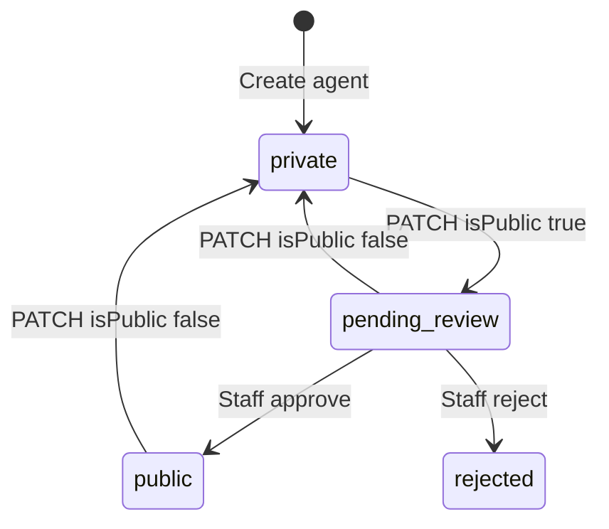

An agent starts private. To put it on the marketplace you ask for a listing with `isPublic: true`, and EchoZero staff review the request. `listingStatus` shows where the review stands.

<Note>
The beta stage was removed. There is no pilot cohort and no 30-day auto-promotion. `betaStartDate` is ignored on write, and older fields such as `betaStatus` may still appear in some responses. Use `isPublic` to ask for a listing and read `listingStatus` for the result.
</Note>

## How listing works



| Value | Meaning |
| --- | --- |
| `isPublic: false` | Private. Not on the marketplace |
| `listingStatus: pending-review` | You asked to list the agent. Staff are reviewing it. It stays private meanwhile |
| `listingStatus: public` | Approved and on the marketplace |
| `listingStatus: rejected` | Not approved. Read the review notes, fix the agent and ask again |

- Sending `isPublic: true` asks to list the agent. An agent that is already approved is listed straight away. Otherwise it stays private and goes to staff review.
- Sending `isPublic: false` makes the agent private and cancels a pending review.
- You cannot set `listingStatus` yourself. A request that tries to change it is rejected with `LISTING_STATUS_STAFF_ONLY`. The field also allows `beta` and `shadow-monitoring`, which only staff set.

## Creating an agent

`POST /api/v1/agents` with your developer API key. New agents are private.

Include:

- `name`: 20 characters at most
- `agentVenue`: `JUPITER` (Solana spot) or `HYPERLIQUID` (perpetuals). It cannot be changed after creation. For `HYPERLIQUID`, also include `signalExecutionDefaults: { "marketType": "perpetual" }` in the same body. The spec says it is derived from the venue and ignored on write, but older builds rejected HYPERLIQUID creates without it with a 400. See the [Hyperliquid recipe](/recipes/hyperliquid-perp)
- `signalSourceKind`: `webhook` for HTTP ingress (returns `inboundWebhookSigningSecretReveal` once) or `signal_group` for Telegram/Discord (see [Signal groups](/guides/signal-groups))

## Requesting a listing

```bash
# ez is the signed helper from "API keys and HMAC"
ez PATCH "/api/v1/agents/$AGENT_ID" '{ "isPublic": true }'
```

Then poll the agent and read `listingStatus`:

```bash
ez GET "/api/v1/agents/$AGENT_ID"
```

Marketplace responses also carry `latestReview` when a review exists.

## Owner stake

Agent responses include an `ownerStake` object with `enabled`, `requiredUsd`, `floorUsd`, `currentUsd`, `lockedUsd`, `shortSince`, `delistedAt`, `waived` and `ownerFunded`. In short: the owner's own real-money balance on the agent must reach `requiredUsd` to go public, the locked part cannot be withdrawn while the agent is public or waiting for review, and the agent stays listed while the stake is at least `floorUsd`. If the stake is short, `shortSince` shows since when. Read the field descriptions in the API reference for the exact rules.

## Reasoning and safety

Structured signals require `reasoning` (1-4000 chars). Feed safety filters may reject signals with banned content. Strong reasoning and consistent signal quality improve review outcomes.

## Going live checklist

1. Set pricing (`marketplacePricingModel`, `marketplaceMonthlyPrice`, `marketplaceSuccessFeePercent` 0-22, default 20). See [Earnings and payouts](/guides/earnings)
2. Configure ingress (webhook secret or Telegram/Discord verification)
3. Test in [virtual wallet mode](/guides/sandbox)
4. Send `isPublic: true` to submit the agent for listing review
5. Read `listingStatus` until it shows `public` or `rejected`

## Signals and agent status

If a signal comes back `skipped` with `agent_status_blocked`, the agent's status does not currently allow execution. Check the agent and its `listingStatus`, then see [Error codes](/guides/error-codes).
