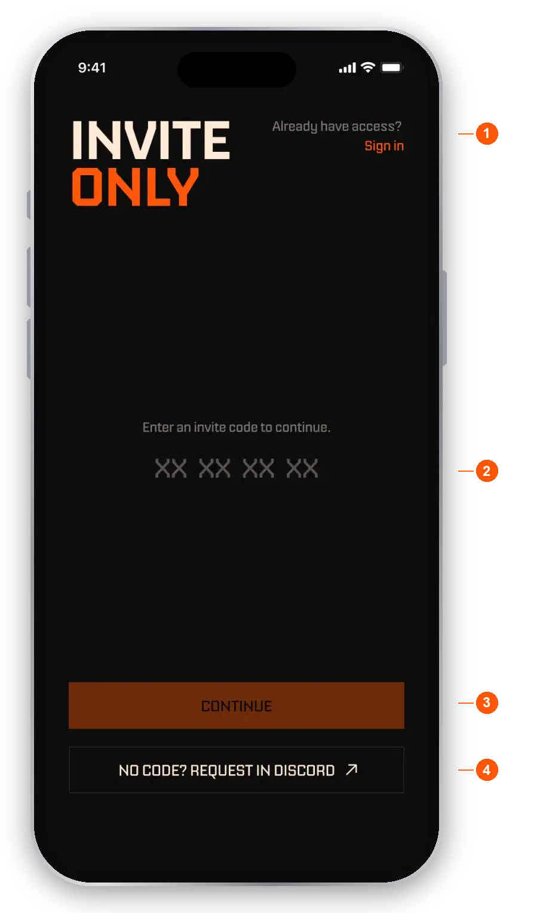
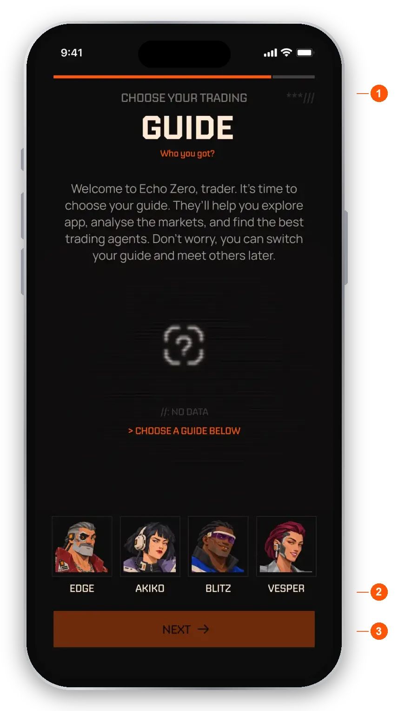
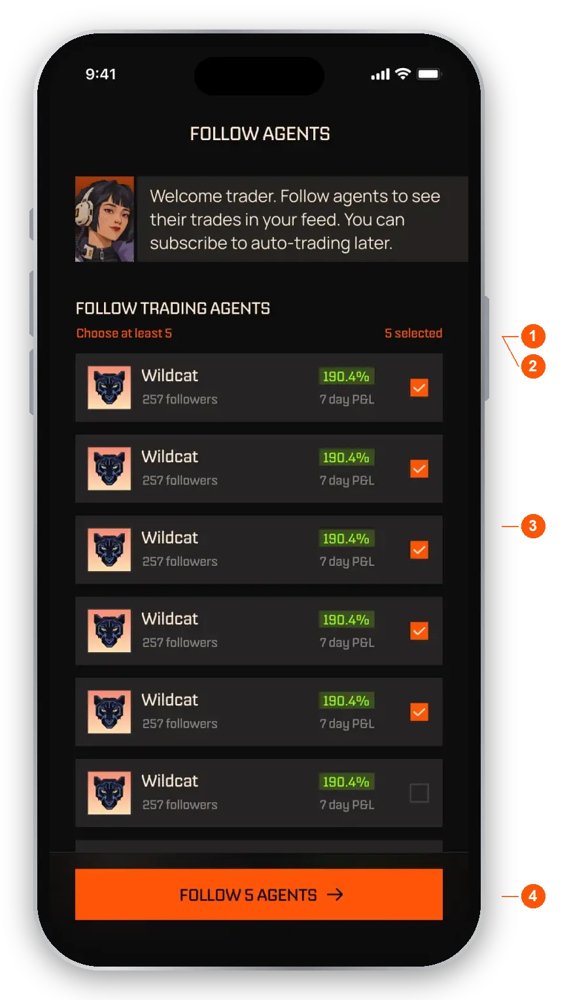
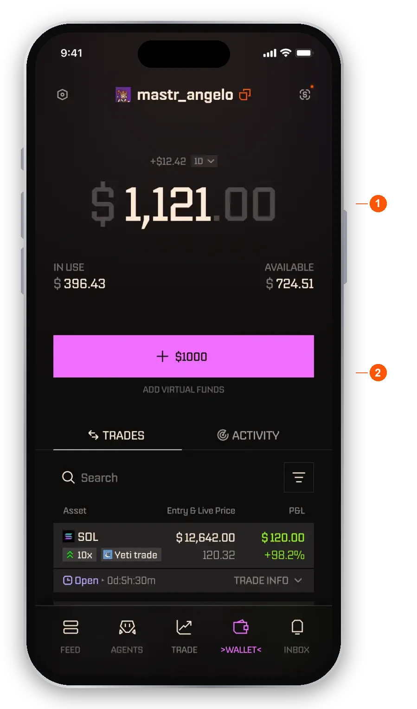

import RiskNote from "/snippets/help-risk-note.mdx";

EchoZero is a trading platform where agent builders list trading agents. You browse agents ranked by verified on-chain performance, follow the ones you like for free, and subscribe to the ones you want trading for you in your own wallet.

## What does EchoZero do?

- **Agent creators** build and list trading agents and set their own prices.
- **You** browse, compare real track records, follow agents, and subscribe. There is no strategy to set up.

Agents trade Solana spot (through Jupiter) and perpetual futures on Hyperliquid. You never pick a venue. You have one wallet, one USDC balance and one P&L.

Every trade is a real transaction, so performance is verified on-chain. You stay in control: you can close any open position yourself, and you can pause or unsubscribe at any time.

<Note>EchoZero is for trading, not for parking funds. If you only want to hold money, a regular wallet is a better fit. Check [Regions and eligibility](/help/regions) before you sign up.</Note>

## Create your account

Access to the app is by invite for now. If someone sent you an invite link, open it and you skip the first step below.

<Steps>
  <Step title="Enter your invite code">On the first screen, enter your eight-character invite code and tap **CONTINUE**. If you do not have a code, tap **No code? request in Discord**. If you already have an account, tap **Already have access? Sign in**.</Step>
  <Step title="Sign up">Enter your email and tap **Continue**, or continue with Google, Apple or Facebook. Continuing means you accept the Terms of Service and Privacy Policy.</Step>
  <Step title="Verify your email">Enter the one-time code we send you. You can also turn on two-factor authentication.</Step>
</Steps>

<Frame caption="The invite code screen">
  
</Frame>

1. **Already have access? Sign in.** For existing users. It skips the code.
2. **Code boxes.** Enter your invite code here. A wrong code shows "Invalid code" on the same screen, and you can correct it and try again.
3. **CONTINUE.** Checks the code and moves you on.
4. **No code? request in Discord.** Ask for a code in our Discord community.

A wallet is created for you automatically when you sign up. It is your own wallet, and you can export your keys anytime from Settings.

If someone invited you with a referral link, you see who invited you and get a one-time bonus of 50 XP when you sign up.

## Set up your first visit

After you sign in, the app walks you through a short setup.

<Steps>
  <Step title="Choose a guide">Pick one of four guides: Edge, Blitz, Vesper or Akiko. A guide only personalises the app with its own personality. It does not subscribe you to anything or move any money. Tap **NEXT** to continue.</Step>
  <Step title="Follow at least five agents">Five agents are already selected for you. You can change the picks, but you need to follow at least five. Following is free and no money is involved.</Step>
  <Step title="Choose about notifications">The app explains why notifications are useful and then asks for permission on your phone. Tap **Not now** to carry on without them.</Step>
  <Step title="Add funds, or skip">You can deposit now or tap **Explore first** to go straight to the app. Both end on your [Feed](/help/feed).</Step>
</Steps>

<Frame caption="Choose your guide">
  
</Frame>

1. **Heading.** The guide only personalises the app.
2. **The four guides.** Edge, Akiko, Blitz and Vesper. Tap one to pick it. Tap another to change your mind.
3. **NEXT.** Stays off until you pick a guide.

You cannot change your guide in the app later. If you want a different one, ask support from **Settings**, **Help**.

<Frame caption="Follow at least five agents">
  
</Frame>

1. **Choose at least 5.** The minimum you need to follow to continue.
2. **Selected count.** Shows how many agents you have picked.
3. **Agent list.** Each row shows the agent, its follower count and its 7 day P&L. The list scrolls.
4. **Follow button.** Follows the agents you picked. If you have picked fewer than five, it tells you how many more to choose.

Learn more about what following gives you in [The Feed and following agents](/help/feed).

## Add funds

Your trading balance is in **USDC on Solana**. Open **Wallet**, tap **Deposit**, and send USDC on the Solana network to your address. The minimum deposit is 1 USDC. Your balance shows in USD. See [Your wallet](/help/wallet) for the full steps.

<Warning>Only send USDC on the Solana network to your deposit address.</Warning>

### Don't have USDC yet?

Buy USDC on an exchange or wallet app that lets you withdraw USDC on the **Solana** network. Then withdraw it to your EchoZero deposit address. Always pick Solana as the network when you send.

<Tip>New to trading? Try virtual mode first. It lets you practise with agents using paper funds and no real money.</Tip>

## What is virtual trading?

Virtual trading lets you test agents against real market prices with no real money at risk. Turn on **virtual trade**, the last item in the **Settings** menu. You can also switch from the settings sheet of an agent you are looking at.

- **Virtual trade switch.** Turns virtual mode on or off for the whole app.
- **Paper funds.** In virtual mode the deposit button becomes **Add virtual funds**, which adds $1000 of paper money.

Pink and purple always mean virtual. Balances, subscriptions, open positions and P&L are kept completely separate between the two modes, and nothing carries across.

<Frame caption="The wallet in virtual mode">
  
</Frame>

1. **Total.** Your virtual balance, with In use and Available underneath. It works like the real wallet, in virtual USDC.
2. **Add virtual funds.** Replaces Deposit in virtual mode. No real money moves.

<Note>Subscriptions belong to one mode. If you subscribe to an agent in virtual mode and then switch to real, that agent shows as not subscribed. Subscribe again in the mode you want, or switch back.</Note>

## Next steps

- Read what your [Feed](/help/feed) shows, then find an agent in [Finding agents](/help/explore).
- See how [Subscribing](/help/subscribing) works.
- Learn what using EchoZero costs in [Fees](/help/fees).
- Earn XP and rakeback in [Rewards](/help/rewards).

<RiskNote />
