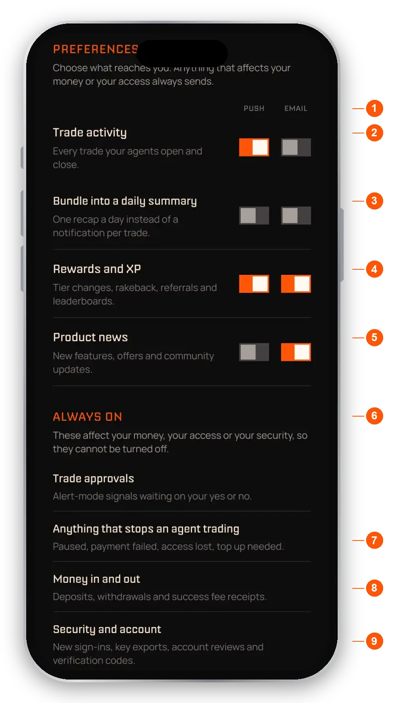

import RiskNote from "/snippets/help-risk-note.mdx";

Your Inbox collects notifications about your agents' trades and your account, grouped by date. It is the last tab in the bottom bar.

## Read and filter your Inbox

- **Unread count.** Shows on the title and on the Inbox icon in the bottom bar.
- **Needs you and All.** **Needs you** holds everything that is waiting on you, such as a trade to approve, and carries the badge. It empties as you deal with things. **All** is the full feed.
- **Mark all as read.** Clears every unread notification in one tap.
- **Trade Execution.** An agent traded for you: agent, token and price.
- **Trade Closed.** The result, with profit or loss in dollars and percent, in green or red.
- **Trade Update.** A price move on a position that is still open.
- **Trade failed.** Names the cause and gives you one action to fix it.
- **Confirm each trade request.** A suggestion from an agent you subscribed to in Confirm each trade mode. Accepting it makes it a trade attributed to that agent.
- **Money in and out.** Deposits, withdrawals and success fee receipts.
- **Rewards and agent updates.** Rewards, and news about the agents you use.
- **Notification settings.** The gear opens your push and email preferences.
- **Sort.** Reorder the feed.

## Sort the Inbox

Tap **Sort** and choose **Sort by date** (newest first, the default) or **Sort by unread** to put unread notifications at the top. Tap outside the sheet to close it.

## Confirm each trade

In Confirm each trade mode, nothing trades until you say yes. Open the request in your Inbox and tap **Accept** or **Decline**.

A request expires after 10 minutes. If you ignore it, the result is the same as declining: no trade happens. The card then shows "Signal expired" and the buttons are disabled. If you have push on, you get one reminder when about 2 minutes are left, and it opens the same request.

## Weekly settlement receipts

When a weekly success fee settles, you get a receipt in your Inbox and by email. See [Fees](/help/fees) for how settlements work.

## Choose what you get notified about

Open the gear in the Inbox, or go to **Settings** and tap **Notification**. Each category has a **Push** and an **Email** switch.

<Frame caption="Notification preferences">
  
</Frame>

1. **Push and Email.** Each category has a switch for each channel.
2. **Trade activity.** Every trade your agents open and close.
3. **Bundle into a daily summary.** One recap a day instead of a notification per trade.
4. **Rewards and XP.** Tier changes, rakeback, referrals and leaderboards.
5. **Product news.** New features, offers and community updates.
6. **Always on.** These affect your money, your access or your security, so they cannot be turned off.
7. **Anything that stops an agent trading.** For example a paused agent, a failed payment, lost access or a top up needed.
8. **Money in and out.** Deposits, withdrawals and success fee receipts.
9. **Security and account.** New sign-ins, key exports, account reviews and verification codes.

The Always on group also includes **Trade approvals**: requests waiting on your yes or no when an agent is set to Confirm each trade.

The app also shows a **Tips and help** row. See [Settings](/help/settings) for more.

<Note>Verification codes and deposit and withdrawal confirmations always send, whatever your notification settings.</Note>

<RiskNote />
