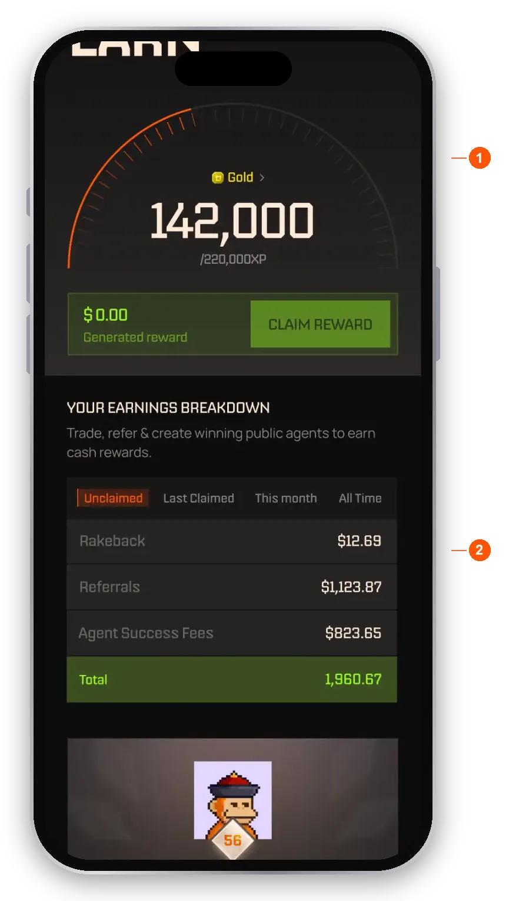
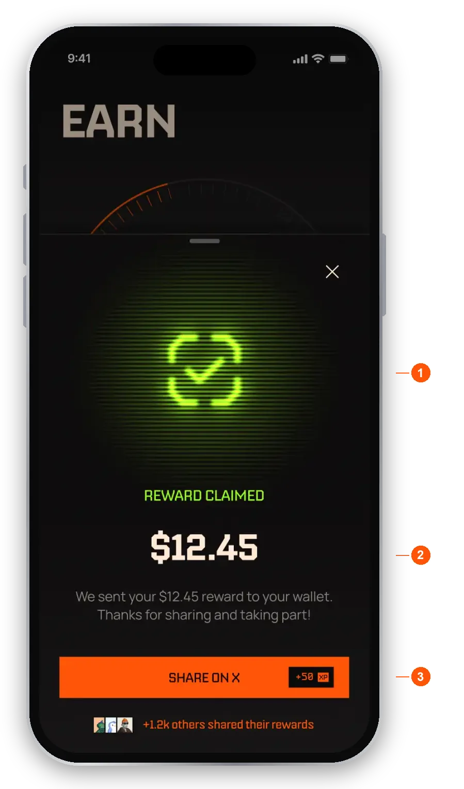
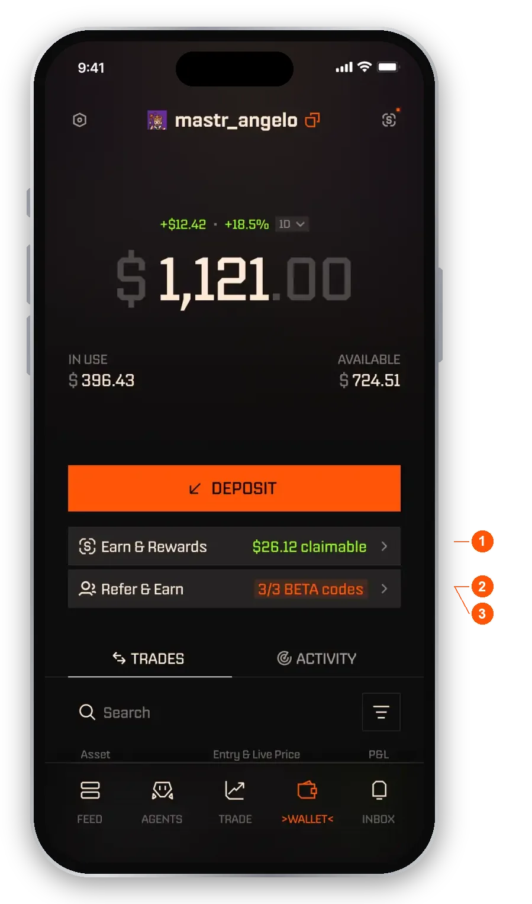
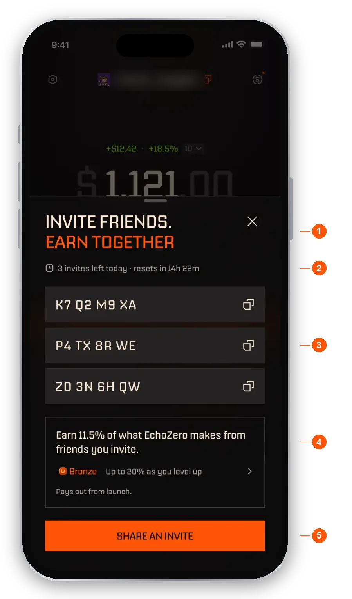
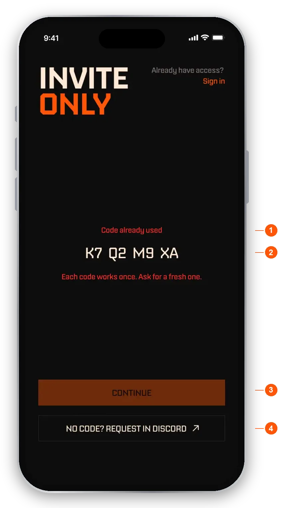

import RiskNote from "/snippets/help-risk-note.mdx";

<Note>Rewards are optional. You can use EchoZero without ever claiming them.</Note>

Earn shows your tier, your XP and the rewards waiting for you. Rewards are paid in USDC to your wallet. Earn opens from **Wallet**, not from the bottom bar.

## Find your tier and claim rewards

<Steps>
  <Step title="Open Earn">Tap **Wallet** in the bottom bar, then tap **Earn & Rewards**.</Step>
  <Step title="Check your reward">The generated reward amount sits under the XP gauge. The **CLAIM REWARD** button is always visible.</Step>
  <Step title="Claim">Tap **CLAIM REWARD**. The reward is paid in USDC to your wallet, and you get a confirmation with the amount.</Step>
</Steps>

<Frame caption="The Earn page">
  
</Frame>

1. **XP gauge, tier and CLAIM REWARD.** Your tier and lifetime XP, and what you can claim now, paid in USDC. Tiers are permanent: once you reach one, you never drop.
2. **Earnings breakdown.** Switch between Unclaimed, Last Claimed, This month and All Time. Earnings are split into Rakeback, Referrals and Agent Success Fees.

Further down the page you can:

- **Open the referral leaderboard.** Jump to the monthly leaderboard.
- **Switch between level progress and Your Stats.** See your XP, a breakdown of where it came from, and your earnings.
- **See your level and benefits.** Your tier next to the next one, with the rakeback and referral rate for each, and a table of every tier.
- **Check Activity.** A feed of your payout transactions.
- **Tap SHARE ON X.** It stays on screen so you can share for XP.

<Frame caption="After you claim">
  
</Frame>

1. **Confirmation.** Your reward was claimed, with the amount.
2. **Where it went.** The reward is sent to your wallet as USDC.
3. **Share on X.** Post about it for XP.

## Tiers

Your tier is set by lifetime XP. Your first tier, Wood, starts at 250 XP. Below that you are unranked, and an unranked account does not earn a referral share yet.

| Tier | XP required | Rakeback | Referral |
|---|---|---|---|
| Wood | 250 | 5% | 10% |
| Bronze | 12,000 | 10% | 11.5% |
| Silver | 40,000 | 15% | 13% |
| Gold | 100,000 | 22% | 14.5% |
| Platinum | 220,000 | 28% | 16% |
| Diamond | 400,000 | 35% | 18% |
| Champion | 750,000 | 40% | 20% |

Tiers do not give fee discounts. Instead, every tier gives you back a bigger share of what EchoZero itself earns. See [Fees](/help/fees) for how fees work.

## Rakeback

Every success fee includes EchoZero's fixed 8% platform fee. Rakeback returns a share of the platform fee **you** paid, from 5% at Wood to 40% at Champion. It builds up each time a success fee settles (weekly, or when you withdraw or unsubscribe) and you claim it from Earn in USDC.

Rakeback only builds up in weeks where an agent made you new profit. If you paid no fee, there is nothing to rake back. It never applies to subscriptions or to the creator's share of the success fee.

## Referrals

Referral rewards are separate from rakeback. You earn a share of the platform fee EchoZero collects from the people you refer, from 10% at Wood to 20% at Champion. It is ongoing and settles on the same schedule as their success fees.

Referral payouts start from launch. The invite sheet shows "Pays out from launch" until then.

Your referral still earns their own rakeback. The two do not overlap, and you never earn rakeback on someone else's trading. Combined payouts from a settlement may be capped.

**When a referral qualifies.** A referral qualifies once they have been genuinely active on EchoZero for a few weeks. You earn +100 XP when they qualify. Commission starts building at that point but is held, and it is released, along with a further +400 XP, after a further retention period. You can see each referral's status in Earn.

### Monthly referral leaderboard

Referrers are ranked each calendar month by qualified referrals. The top 100 win XP prizes, from 10,000 XP for 1st place down to 250 XP for places 51 to 100. Prizes are for the current season and may change between seasons.

- **Your rank and time left.** Shows where you stand this month and how long is left.
- **This Month, Last Month, All Time.** Switch the period.
- **Ranked list.** Rank, user, XP reward and referral count.

## Invite codes: share EchoZero with a friend

While EchoZero is invite-only, you can give friends a code to join. You get a few single-use codes each day, and you share them from Wallet.

### Share a code

<Steps>
  <Step title="Open Wallet">Tap **Wallet** in the bottom bar.</Step>
  <Step title="Tap Refer & Earn">The row sits under **Earn & Rewards**. If you do not see it, invite codes are not switched on for the app right now.</Step>
  <Step title="Share">Tap **SHARE AN INVITE** to send the next unshared code, or tap a code to copy it or its link.</Step>
</Steps>

<Frame caption="Refer & Earn on Wallet">
  
</Frame>

1. **Earn & Rewards.** Opens Earn.
2. **Refer & Earn.** Opens the invite sheet.
3. **Codes left today.** An amber badge, for example "3/3", shows how many codes you have left today.

<Frame caption="The invite sheet">
  
</Frame>

1. **Title.** "Invite friends. Earn together."
2. **Invites left today.** How many codes you have left, and how long until they reset.
3. **Your codes.** Each code is single-use. Tap an unused code to **Copy code**, **Copy invite link** or **Share**. A copied code counts as shared.
4. **Earnings line.** The share of what EchoZero makes from friends you invite, at your level. While it reads "Pays out from launch", referral earnings are not paid out yet. Tap the card to see the levels.
5. **SHARE AN INVITE.** Sends the next unshared code as a full invite: a short message, your code and a link.

How codes work:

- **Single use.** Each code works once. A used code is crossed out and shows "Joined" with your friend's handle.
- **Resets daily.** New codes arrive every day at midnight UTC. Unused codes do not carry over, and a code from an earlier day shows as expired.
- **All used.** When every code is used, the button is disabled and the sheet shows when your next invites arrive.

### How a friend joins

A friend can join in two ways.

- **With a code.** At the invite screen, they type the code. A welcome screen names you as the person who invited them, then they sign up.
- **With a link.** The link looks like `echozero.app/r/` followed by the code. Tapping it applies the code for them, skips the invite screen and goes straight to the welcome and sign-up. Pasted into a chat, the link can show a card with your name, "+50 XP when you join" and the date it is valid until.

Your friend earns a +50 XP joining bonus. The code is used up when their account is created, not when they type it. See [Getting started](/help/getting-started) for the rest of sign-up.

After tapping your link, your friend sees a welcome screen. It names you as the person who invited them, shows their +50 XP joining bonus, and has a **Get started** button that continues to sign-up.

### If a code does not work

<Frame caption="A code that was already used">
  
</Frame>

1. **Reason.** "Code already used" means each code works once. "Code expired" means the code is from an earlier day, since codes reset daily. Your friend needs a fresh code from you.
2. **Prefilled code.** The screen opens with the code filled in.
3. **Continue.** Stays disabled until your friend changes the code.
4. **Request in Discord.** A way to ask for help if your friend does not have a valid code.

## Earn XP

| Source | Rate | Cap |
|---|---|---|
| Trading | 1 XP per $10 traded | 2,500 XP/day |
| Referrals | +100 per qualified referral, +400 after the retention period | none |
| Social shares | 50 XP per validated share | 200 XP/week |
| Trade feedback | XP for explaining your trades | Counts toward the daily cap below |
| Creator XP (public agent owners) | 1 XP per $300 of subscriber volume | 25,000 XP/month |

A global cap of 3,000 XP per day applies across all sources.

### Make your XP count

- **Genuine trading counts.** Very short holds and stablecoin pairs earn reduced Trading XP.
- **Wash trading does not count.** Round trips and self-dealing earn no XP.
- **Social shares** need a linked X account and real engagement to be validated.
- **Trade feedback** is only counted on genuine trades. Low-effort or instant submissions are not counted, and honest notes are worth more.
- **Creator XP** is earned from paying subscribers who stay subscribed over time.

## Share to earn

Connect your X account to share your referral link, and connect Discord for in-app XP and private Discord channels. EchoZero only reads your public profile (username and picture) and never posts without your action. You can disconnect any time in Settings.

- **Share card.** A branded card with your referral link.
- **Post text.** Pre-written, and you can edit it before posting.
- **Share on X.** Posts the card. Validated shares earn XP.

You can also share a branded referral QR code. Every scan that signs up uses your referral link.

<Tip>If your rewards or XP look lower than expected, see [Troubleshooting](/help/troubleshooting).</Tip>

<RiskNote />
