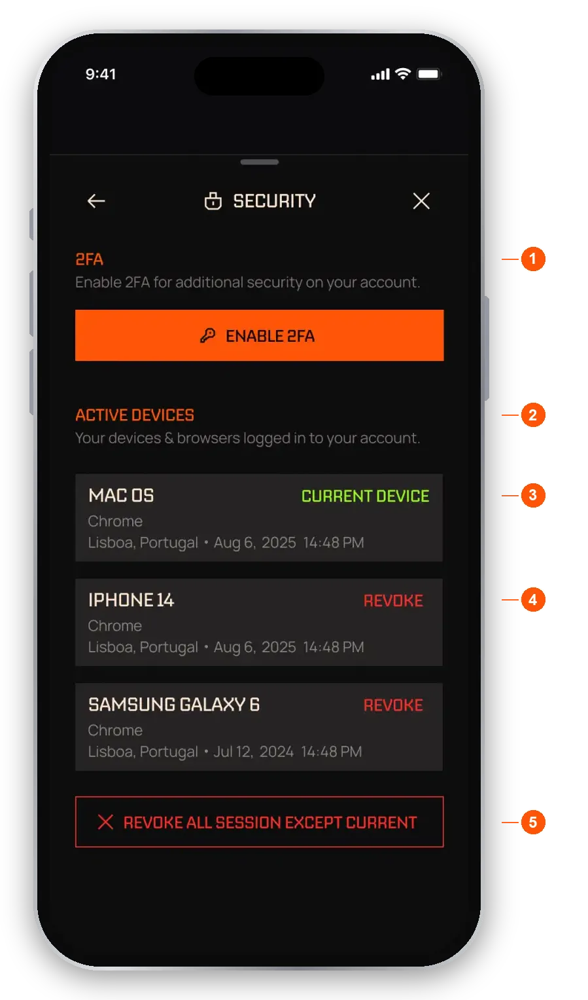

import RiskNote from "/snippets/help-risk-note.mdx";

## Is EchoZero safe?

- **Your balance is held in a wallet created for you.** You can export its key at any time from **Settings**. See [Settings](/help/settings#export-your-keys).
- **Every trade is a real on-chain transaction.** Agent performance comes from real trades, not backtests.
- **You stay in control.** You can close any open position, pause an agent or unsubscribe at any time, and withdraw whatever is available.

## Protect your account

<Steps>
  <Step title="Turn on 2FA">Open **Settings** from the Wallet tab, go to **Security**, and set up an authenticator app. See [Settings](/help/settings#turn-on-two-factor-authentication-2fa).</Step>
  <Step title="Require 2FA for the risky actions">Once 2FA is on, require it for logging in, removing a device and withdrawing.</Step>
  <Step title="Check your devices">In **Security**, look at your active devices. Revoke any you do not recognise.</Step>
</Steps>

<Frame caption="Security in Settings">
  
</Frame>

1. **2FA.** Turn two-factor authentication on. Once it is on, you choose which actions ask for a code.
2. **Active devices.** Where you are signed in.
3. **Current device.** The one you are using now.
4. **Revoke.** Signs one device out.
5. **Revoke all except current.** Signs out every other device.

## Never share these

- **Your private key.** Anyone with it can take your funds. Only reveal it on the **Export keys** screen, with nobody watching.
- **Your 2FA codes or email verification codes.**
- **Your login.**

<Warning>EchoZero will never ask for your private key, 2FA codes or verification codes. Anyone who does is a scammer, even if they use our name or logo.</Warning>

The app itself asks for a code in a few places, such as before it shows your key or when you delete your account. Enter it only in the app, never in a chat, a message or a website someone sent you.

## Common scams

<AccordionGroup>
  <Accordion title="Someone messaged me claiming to be EchoZero support">
    Do not reply and do not click their links. EchoZero support never messages you first on Discord, Telegram, X or email. Real support only happens through **Help** in Settings, the Discord server linked from the app, or hello@echozero.app. Report the account.
  </Accordion>
  <Accordion title="A website or app looks like EchoZero">
    Only use the official app and echozero.app. Check the address before you sign in. If in doubt, close it and open the app directly.
  </Accordion>
  <Accordion title="Someone promised guaranteed returns">
    No agent can guarantee profit. Anyone promising fixed or guaranteed returns, or asking you to send them funds to trade for you, is not EchoZero.
  </Accordion>
  <Accordion title="I was asked to send funds to verify or unlock my wallet">
    EchoZero never asks you to send funds to verify, unlock or upgrade anything. Do not send.
  </Accordion>
  <Accordion title="I exported my key. Can EchoZero still trade for me?">
    Yes, exporting does not stop your agents. If you then spend from the exported wallet somewhere else, such as Phantom, your agents are paused until your balances reconcile, and you are told in the app and by email.
  </Accordion>
</AccordionGroup>

## Before you withdraw

- Withdrawals go to a **Solana** address in USDC. The app checks the address format, but it cannot know whether the address belongs to you.
- Copy and paste the address, then check the first and last few characters.
- Blockchain transactions cannot be reversed once confirmed.

## If you think your account is at risk

<Steps>
  <Step title="Revoke other devices">Go to **Settings**, then **Security**, and revoke all devices except the one you are using.</Step>
  <Step title="Turn on 2FA for withdrawals">If 2FA is off, turn it on and require it for withdrawals.</Step>
  <Step title="Move your funds if needed">Withdraw available USDC to a Solana wallet you control. See [Wallet](/help/wallet).</Step>
  <Step title="Contact us">Email hello@echozero.app or use **Help** in Settings. Tell us what happened and when.</Step>
</Steps>

<RiskNote />
