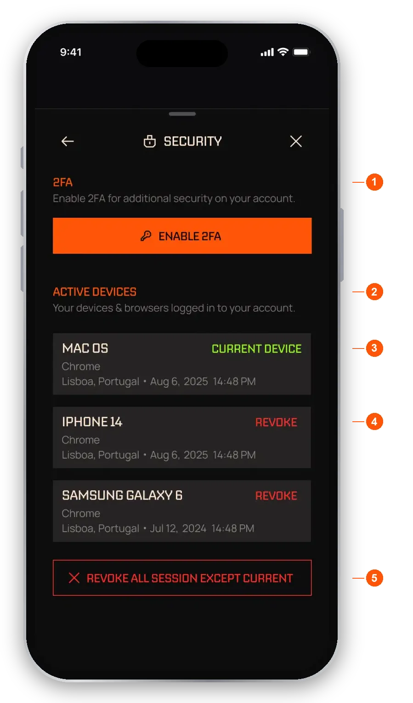
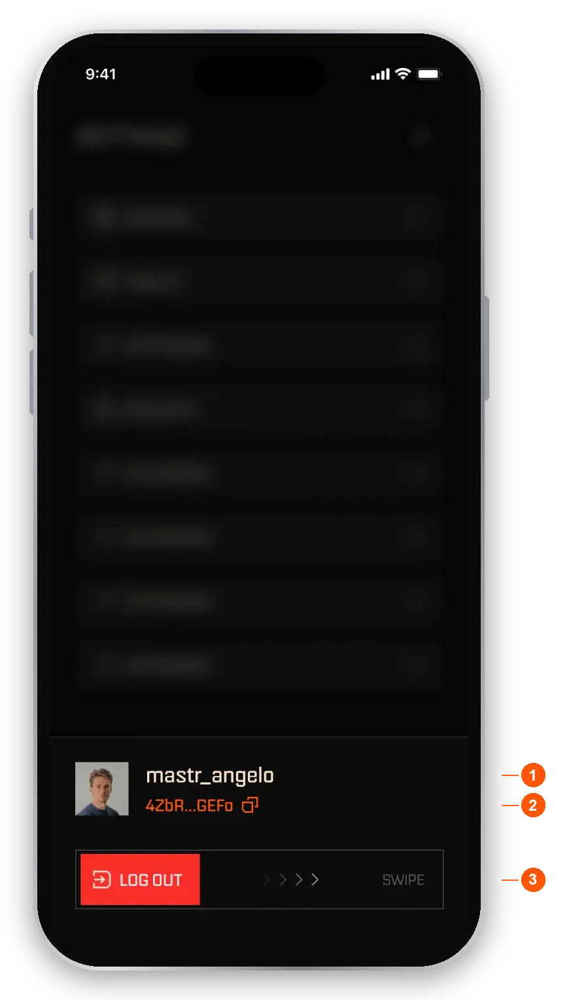
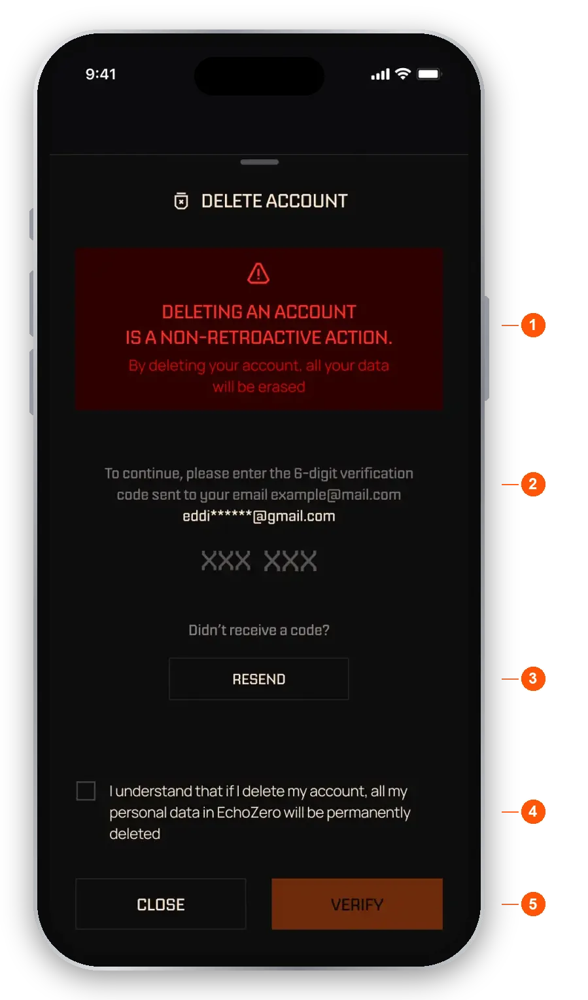

import RiskNote from "/snippets/help-risk-note.mdx";

Open **Settings** from the Wallet tab. Everything about your account starts here.

The menu has these rows, top to bottom:

- **General.** Profile image, username, email and language.
- **Wallet.** Wallet controls, including Export keys.
- **Withdraw.** Opens the withdraw flow. See [Wallet](/help/wallet#withdraw-usdc).
- **Security.** Two-factor authentication and your signed-in devices.
- **Notification**, **Connections**, **Feedback**, **Subscriptions** and **Log out**.

At the bottom are **Help**, where you get support, and the **virtual trade** switch, which moves the app between virtual and real trading.

## General

In **General** you can add or remove a profile picture (5MB max, PNG or JPG) and see your username and email. You can also change the app language. Tap **Save** to keep your changes. This is also where you start [account deletion](#delete-your-account).

## Turn on two-factor authentication (2FA)

<Steps>
  <Step title="Open Security">Go to **Settings**, then **Security**.</Step>
  <Step title="Get an authenticator app">Download one, for example Google Authenticator.</Step>
  <Step title="Add EchoZero">Scan the QR code, or type in the setup key instead.</Step>
  <Step title="Confirm">Tap **Continue** and enter the 6-digit code from the app to switch 2FA on.</Step>
</Steps>

Once 2FA is on, you can require it for specific actions: logging in, removing a device and withdrawing tokens. You can turn 2FA off from the same screen.

<Frame caption="Security">
  
</Frame>

1. **2FA.** Turn it on and choose which actions ask for a code.
2. **Active devices.** See where you are signed in.
3. **Current device.** The one you are using now.
4. **Revoke.** Signs one device out.
5. **Revoke all except current.** Signs out every other device.

## Export your keys

Your wallet is yours. You can export your Solana private key at any time and import it into Phantom to take full control.

<Steps>
  <Step title="Open Export keys">Go to **Settings**, then **Wallet** and **Export keys**.</Step>
  <Step title="Verify it is you">We email you a code. Enter it in the app. It opens a 2-minute window to export your key.</Step>
  <Step title="Reveal and copy">Tap the box to show your key, then copy it. Tap **CLOSE** when you are done.</Step>
</Steps>

- **Safety warning.** Never share your key. Anyone with it can control the wallet.
- **Reveal note.** Tap the box to show the key, and make sure nobody can see your screen.
- **The key.** Hidden until you tap it. Copy it to your clipboard.

Your wallet can only be recovered using its private key, so keep a copy somewhere only you can reach.

Exporting does not stop your agents from trading. If you then spend from the exported wallet somewhere else, your agents are paused until your balances reconcile, and you are told in the app and by email.

<Warning>Anyone with your private key can take your funds. Never share it.</Warning>

## Manage your subscriptions

Go to **Settings**, then **Subscriptions**. Each paid agent you subscribe to shows its price and next payment date.

- **Cancellation terms.** Access continues until the paid period ends. There is no pro-rated refund.
- **CANCEL.** Cancel that one agent.
- **Cancel all agent subscriptions.** Cancel every subscription at once.

When you cancel, you choose what happens to the agent's open trades. **Keep them open** is the default. Your trades stay open and you can close them from your wallet whenever you like. **Close all trades** exits every open position at market. After you cancel, you can choose **Keep following for free**. You can re-subscribe at any time.

Cancelling settles any success fee due on profit above your all-time high with that agent. See [Fees](/help/fees) and [Subscribing](/help/subscribing).

## Notifications

Go to **Settings**, then **Notification**. You get a grid with a **Push** and an **Email** switch for each category.

- **Trade activity.** Every trade your agents open and close.
- **Bundle into a daily summary.** One recap a day instead of a notification per trade.
- **Rewards and XP.** Tier changes, rakeback, referrals and leaderboards.
- **Product news.** New features, offers and community updates.
- **Tips and help.** Getting started and suggestions based on how you use the app.
- **Always on.** Some things cannot be turned off because they affect your money, your access or your security: trade approvals, money in and out (deposits, withdrawals and success fee receipts), and security and account messages such as new sign-ins and verification codes. See [Inbox](/help/inbox).

## Connections

**Connections** is where you link your Telegram and Discord accounts.

## Send feedback

Go to **Settings**, then **Feedback**.

- **Report a bug.** Add the details and a screenshot if you like (5MB max, PNG or JPG), then submit. You are notified as it progresses.
- **Feature request.** Submit an idea with a title and description.

## Get help

Tap **Help** in Settings. It opens a chat that starts with a bot and can hand you over to the support team. You can also reach us in Discord or at hello@echozero.app.

## Log out

Tap **Log out**. The screen shows your username and a shortened wallet address. Swipe the slider to confirm.

<Frame caption="Log out">
  
</Frame>

1. **Account.** The username you are logging out of.
2. **Wallet address.** Shortened, so you can check which account it is.
3. **Swipe to log out.** Slide to confirm.

## Delete your account

Deleting your account cannot be undone in the app. EchoZero may keep some records where required for security, fraud prevention, legal or compliance reasons. You can only delete once you have unsubscribed from all agents and withdrawn your funds. Nothing is closed for you.

<Steps>
  <Step title="Start deletion">Go to **Settings**, then **General**, then **Delete account**.</Step>
  <Step title="Enter your code">We email you a 6-digit verification code. Enter it.</Step>
  <Step title="Confirm">Tick the box to confirm you understand the data loss, then tap **Verify** and finish the final step.</Step>
</Steps>

<Frame caption="Delete account">
  
</Frame>

1. **Warning.** Deleting an account cannot be reversed.
2. **Code.** The 6-digit code from your email.
3. **Resend.** Sends the code again.
4. **Confirm checkbox.** Acknowledge that your personal data is permanently deleted.
5. **Verify.** Moves you to the final step.

Need help? Tap **Help** in Settings, or see [Troubleshooting](/help/troubleshooting).

<RiskNote />
