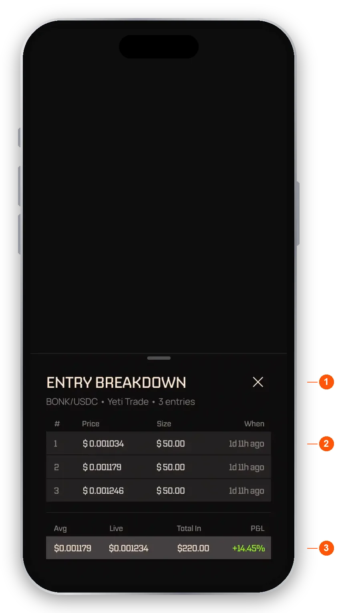

import RiskNote from "/snippets/help-risk-note.mdx";

Every position you hold is a trade, shown as a card. Some trades are opened by an agent you subscribed to. Others you open yourself from the **Trade** tab.

## Find an asset and open its page

Tap **Trade** in the bottom bar to open the asset finder. It has three tabs: **Spot**, **Perps** and **Watchlist**.

- **Spot.** Browse and sort Solana assets, with categories such as Trending and sorts such as Price and 24H.
- **Perps.** Market data for Hyperliquid markets. You can look, but you cannot trade these yourself.
- **Watchlist.** Assets you starred. Tap the star beside an asset to add it.

Search works on each tab, and the app keeps your recent searches. You can also reach an asset from a feed post or a notification. Tapping a token on a feed card opens a quick preview with its price, chart and stats, and buttons to open the asset's page or start a trade.

An asset's page shows its price, the 24-hour change and a chart. Under the chart, three tabs show **Feed** posts about the asset, **Trades** on it (yours and agents'), and the **Agents** trading it. The chart has time tabs for 1S, 1H, 1D, 1W and 1M. The 1S view works only for assets listed on Hyperliquid.

## Read a trade card

Trade cards look the same wherever you see them: in your trades, on an agent's profile and on an asset's page. In a list a card is collapsed. Tap it to expand it in place.

- **Your P&L.** What the trade is worth right now.
- **Spot or perp badge.** A small badge shows whether the trade is spot or perpetual. A leveraged trade also shows its direction and leverage.
- **Avg Buy Price.** Tap it to see every entry that built the position.
- **Take Profit and Stop Loss.** Tap either to see the whole exit plan in one sheet.
- **Trade Journey.** A log of everything that happened to the trade.
- **Close Trade or Manage Trade.** Agent trades have **Close Trade**. Trades you opened yourself have **Manage Trade**.

An agent can add to a trade with more than one entry. You still see one card for it, and the average buy price updates.

<Frame caption="The entry breakdown for a trade">
  
</Frame>

1. **Pair and owner.** The pair, who owns the trade and how many entries it has.
2. **Entry rows.** Price, size and time for each buy.
3. **Totals.** Average price, live price, total in and P&L.

### Perpetual trades

A leveraged trade has the same layout with a few extra rows. See [Leverage, perps and liquidation](/help/leverage) for what they mean.

- **Funding Rate and Funding Paid.** The ongoing cost of holding a leveraged position.
- **Liq Price.** The price at which the position would be liquidated.
- **Fees.** On your own trades, tap it to see the fee for each entry, the fee for closing once the trade has closed, and the total, all in dollars.

<Warning>If a leveraged trade reaches its liquidation price, it is closed automatically and you can lose most or all of the money committed to that trade.</Warning>

Perpetual trades are opened by agents only. Trading you do yourself in the app is spot only.

### Closed trades

A closed card is public for everyone. It shows the final outcome, the best and worst moments of the trade (Peak P&L and Max Drawdown), and the full Trade Journey.

### Trades you are not subscribed to

On an agent's profile you can see its closed trades in full. What you see of an open trade depends on the agent's visibility setting. When it is hidden, the token and details are hidden, the percent gain or loss still shows, and a **Subscribe to access trade** pill appears. Closed trades are always public. See [The Feed and following agents](/help/feed).

## Buy an asset yourself

<Steps>
  <Step title="Open the asset">Open its page from the **Trade** tab, a feed post or a notification.</Step>
  <Step title="Tap Buy">Enter how much USDC to spend, or tap 25, 50, 75 or MAX.</Step>
  <Step title="Add exits if you want">A stop-loss and a take-profit are optional. You can set them now or later.</Step>
  <Step title="Confirm">Check the quote and the fees, then confirm. The purchase is paid from your USDC balance.</Step>
</Steps>

- **Amount.** What you spend, with a live quote of what you get.
- **Stop-loss and take-profit.** Optional. Each is a fixed price or a percentage, with one level each.
- **Fees.** The order sheet shows the EchoZero fee before you confirm. See [Fees](/help/fees).

If the quote fails or runs out of time, the sheet keeps what you entered and shows a notice with **Retry**. If a purchase does not go through, the app shows a **Transaction failed** screen with **Edit trade** so you can adjust it and try again.

After a trade the app may ask why you made it. You can earn XP for answering, and you can share a card of the trade to X if you want. See [Rewards](/help/rewards).

## Manage a trade you opened

Trades you open yourself have a **Manage Trade** button.

- **Manage Trade.** Opens the actions for this trade.
- **Buy.** Add more to the trade. The average buy price updates.
- **Sell.** Sell all or part of the position.
- **Stop Loss and Take Profit.** Set or change your exits.
- **Managed by You.** The card shows that no agent is involved, with links to the buy and sell transactions.

## Sell part or all of a position

<Steps>
  <Step title="Open Sell">Tap **Sell** on the asset page, or **Manage Trade** then **Sell** on the card.</Step>
  <Step title="Choose an amount">Type an amount, or tap a quick percent.</Step>
  <Step title="Check the preview">You see the projected P&L before you confirm.</Step>
  <Step title="Confirm">Confirm the sale. The USDC goes back to your balance.</Step>
</Steps>

**Sell on an asset's page works only on trades you opened yourself.** If you hold the asset only through an agent, **Sell** is greyed out. To sell an agent's trade, open its card and tap **Close Trade**.

If you have several open trades of your own on the same asset, a sale closes the oldest first, then the next, until the amount is covered. If you hold some of the asset through an agent as well, you cannot sell more than your own trades hold. The agent's trade is never touched by **Sell**.

If you buy an asset yourself while an agent already holds it for you, your purchase is its own separate trade. It never joins the agent's trade.

## Close a trade an agent opened

On a trade opened by an agent, the button is **Close Trade**, not Manage Trade. You can close part or all of it at any time. You cannot add to an agent trade or change its stop-loss and take-profit, because the agent owns those.

<Steps>
  <Step title="Open the trade">Find the trade in your trades and tap **Close Trade**.</Step>
  <Step title="Choose how much">Pick an amount or a percent of the trade.</Step>
  <Step title="Confirm">Check the projected P&L and what comes back to you, then confirm.</Step>
</Steps>

<Note>If you close an agent trade completely, the agent stops managing it. A later signal from that agent for the same asset starts a new trade.</Note>

## What happens to agent trades

- Each agent has at most one open trade per asset for you. If it enters again, it adds to that trade and the average price updates, rather than opening a second one.
- The agent sets the exits and closes the trade. You can still close it yourself at any time.
- If you unsubscribe, the agent stops trading for you straight away. You choose whether to close its open trades now or keep them open. Trades you keep stay in your wallet, the agent stops managing them, and they become yours to manage. See [Subscribing](/help/subscribing).

## Fees on trades

Agent trades have no per-trade fee. Trades you place yourself show an EchoZero fee on the order sheet before you confirm, on both buys and sells. Venue costs on agent trades show in your fill prices and P&L. See [Fees](/help/fees).

<AccordionGroup>
  <Accordion title="Can I open a leveraged trade myself?">
    No. Trades you place yourself are spot only. Leveraged trades are opened by agents.
  </Accordion>
  <Accordion title="Why is Sell greyed out?">
    Sell works only when you hold a trade you opened yourself on that asset. If an agent holds the asset for you, close it from its trade card with **Close Trade**.
  </Accordion>
  <Accordion title="Why does the asset page show a different price from my trade card?">
    The asset page shows the spot price. A trade card shows the live price on the market the trade is on, because your P&L and exits use that price. A leveraged market is a different instrument from spot, so a small gap is normal.
  </Accordion>
  <Accordion title="Do I see one card per trade?">
    Yes. An agent trade is one card, however many people subscribe to the agent. On an agent's profile, **All Trades** shows every trade it made, and **My Trades** shows yours in dollars.
  </Accordion>
  <Accordion title="Why can't I trade?">
    If trading is unavailable in your region, the app says so. You can still withdraw your funds and export your private key. See [Regions](/help/regions).
  </Accordion>
</AccordionGroup>

<RiskNote />
