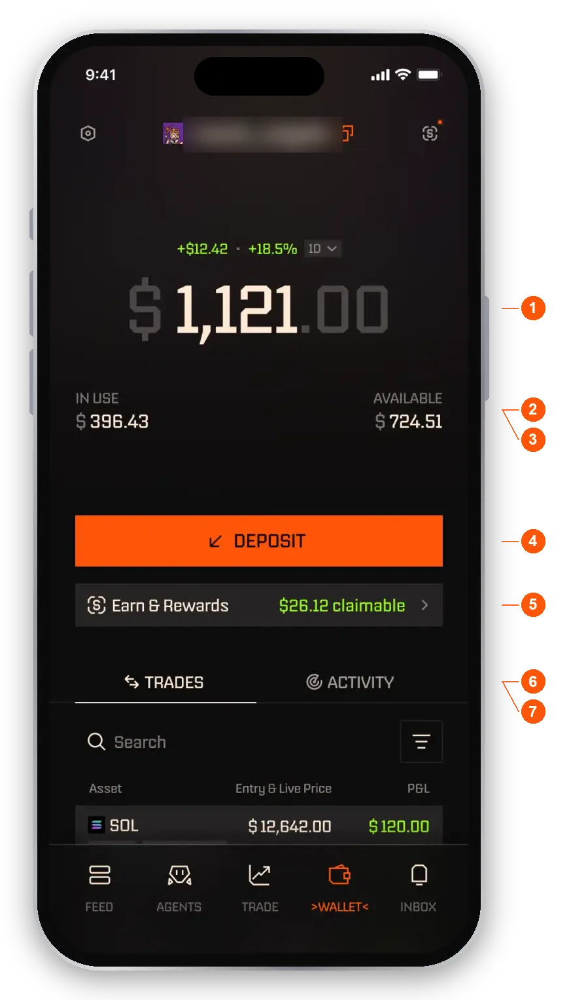
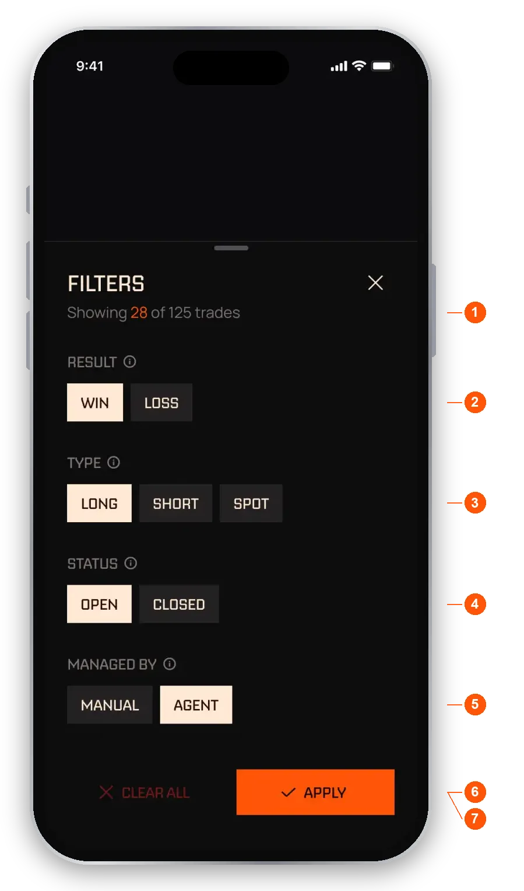
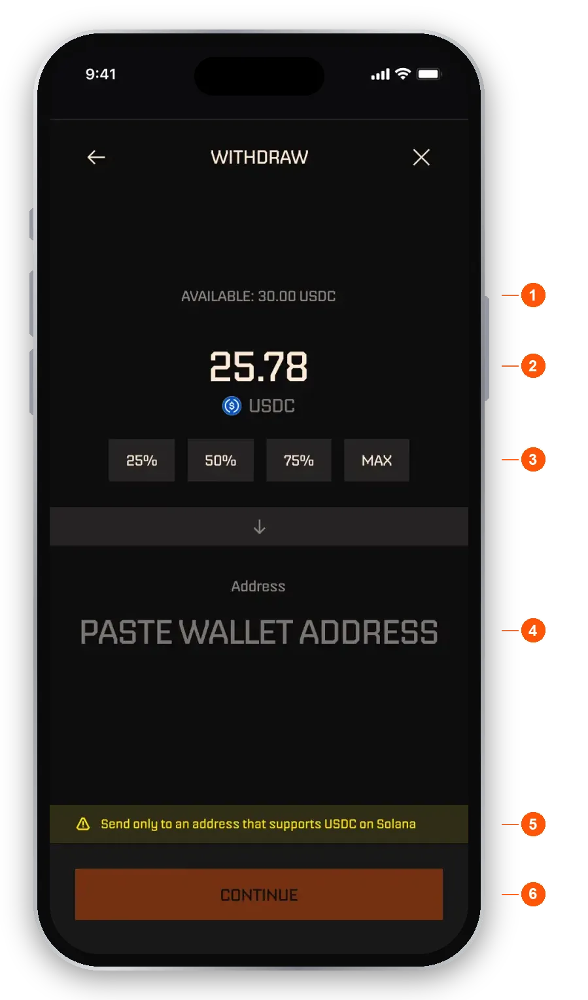
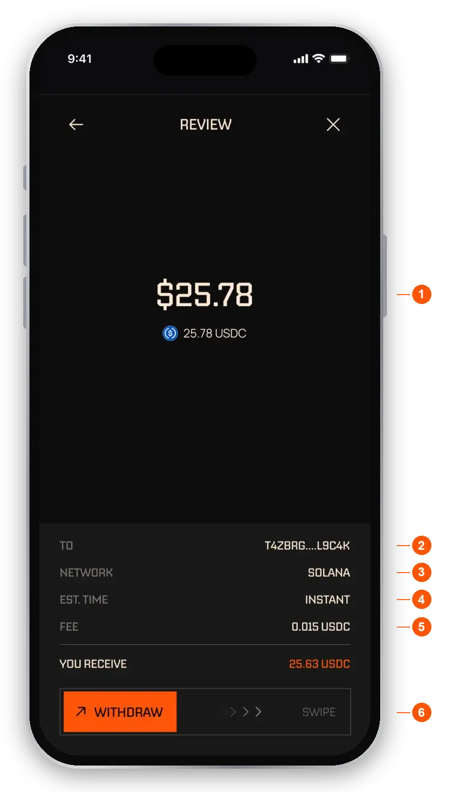
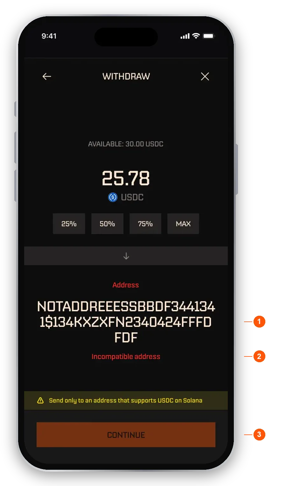

import RiskNote from "/snippets/help-risk-note.mdx";

The **Wallet** tab is your home base. You get one balance in dollars, backed by USDC, and everything you do with your money starts here. Your wallet is created for you when you sign up, and you can export your keys any time from **Settings**.

## Read your balance

<Frame caption="The Wallet tab">
  
</Frame>

1. **Total.** The value of everything you hold, in dollars. It does not drop when an agent moves money to trade.
2. **In use.** Money you have put to work with agents, plus money tied up in open manual trades.
3. **Available.** Total minus In use. This is what you can withdraw right now.
4. **Deposit.** Opens the deposit flow. See [Deposit USDC](#deposit-usdc).
5. **Earn & Rewards.** Shows what you can claim. It reads **Start earning!** when there is nothing to claim yet. See [Rewards](/help/rewards).
6. **Trades.** Your positions.
7. **Activity.** The record of everything that moved your money.

<Note>Your balance is one number, whatever your agents are trading.</Note>

If you use virtual mode, Wallet looks the same but shows virtual funds, kept separate from your real funds.

### Invite codes

A **Refer & Earn** row on Wallet opens the sheet where you share your invite codes. How invites work is explained on [Rewards](/help/rewards).

## Trades

The **Trades** tab lists your positions. Each row shows the token, the entry price and live price, your profit or loss in dollars and percent, whether the trade is open or closed, and how long it has been running. Type in the search field to find a trade by token name. See [Trades](/help/trades) for more.

<Frame caption="The trade filters">
  
</Frame>

1. **Showing count.** How many trades match, for example "Showing 28 of 125 trades".
2. **Result.** Win or Loss.
3. **Type.** Long, Short or Spot.
4. **Status.** Open or Closed.
5. **Managed by.** Manual or Agent, meaning who opened the trade.
6. **Clear all.** Resets every filter.
7. **Apply.** Applies your choices and returns to the list.

With nothing selected, every trade shows.

## Activity

Activity lists every event that moved your money, one line each, newest first.

- **Deposits and withdrawals.** Money in and out of your wallet.
- **Allocated to agent.** Money you moved to an agent. Nothing is gained or lost.
- **Trades.** Bought, sold, opened or closed, with the agent named underneath.

Fee lines appear when a success fee is settled. See [Fees](/help/fees). Rewards you have claimed show up here too. See [Rewards](/help/rewards).

Card payments for subscriptions do not appear here. You will find those in the [Inbox](/help/inbox) and under **Settings**, **Subscriptions**.

## Deposit USDC

<Steps>
  <Step title="Open Wallet">Tap **Wallet** in the bottom bar, then tap **Deposit**.</Step>
  <Step title="Send USDC on Solana">Scan the QR code or copy your address, then send USDC from your other wallet or exchange. Send it on the **Solana** network.</Step>
  <Step title="Wait for it to land">Your balance updates once the transaction confirms, usually within seconds to a couple of minutes.</Step>
</Steps>

- **Your QR code.** It holds your own wallet address.
- **Your address.** Copy it to paste into your other wallet or exchange.
- **Network warning.** Only send USDC on Solana. Tokens sent on other networks will not arrive.
- **Minimum.** The minimum deposit is 1 USDC.

You can also copy your wallet address with the copy button next to your username at the top of Wallet.

<Warning>Double-check the address and the network before you send. A deposit sent the wrong way cannot be recovered by the app.</Warning>

## Withdraw USDC

<Steps>
  <Step title="Start a withdrawal">Tap **Withdraw** next to **Deposit** on Wallet, or go to **Settings**, then **Withdraw**. The button is greyed out when nothing is available.</Step>
  <Step title="Choose what to withdraw">Pick **USDC**.</Step>
  <Step title="Enter an amount">Type an amount, or tap **25%**, **50%**, **75%** or **MAX** to use a share of what is available.</Step>
  <Step title="Paste a Solana address">Paste the address you are sending to. It must be a Solana address.</Step>
  <Step title="Review">Tap **Continue**. The review shows the amount, where it goes, the network, the estimated time and the network fee.</Step>
  <Step title="Swipe to withdraw">Swipe the slider to confirm.</Step>
</Steps>

<Frame caption="Amount and address">
  
</Frame>

1. **Available.** The most you can withdraw right now. It already leaves out money tied up in open trades.
2. **Amount.** Enter it in the token. You can switch to a dollar view of the same amount.
3. **Quick sizes.** 25%, 50%, 75% or MAX of what is available.
4. **Address.** Paste where the money goes. It is shown in full so you can check it.
5. **Network warning.** Send only to an address that supports USDC on Solana.
6. **Continue.** Turns on once the amount and a valid address are set.

<Frame caption="Review before you swipe">
  
</Frame>

1. **Amount.** What you are withdrawing, in dollars and in the token.
2. **To.** The receiving address, shortened.
3. **Network.** Solana.
4. **Est. time.** About how long it should take.
5. **Fee.** The small Solana network fee, shown before you send.
6. **Swipe to withdraw.** Starts the withdrawal.

You can withdraw whatever is available, even while an agent has open trades. Money tied up in an open trade becomes available when that trade closes. If a success fee is due on profit when you withdraw, it is settled at that moment. See [Fees](/help/fees).

After you swipe, the screen reads **Withdrawing** until the transfer is confirmed. **Withdrawn** appears only once it is. It shows where the money went, and **View Transaction** opens the record on Solana. Tap **Ok** to go back to your wallet.

### If the address is not valid

If the address cannot receive USDC on Solana, the address label turns red, **Incompatible address** appears under it, and **Continue** stays greyed out until you fix it.

<Frame caption="An address that will not work">
  
</Frame>

1. **Pasted address.** Shown in full so you can see what you pasted.
2. **Incompatible address.** Paste a Solana address instead. Do not use an address from another network.
3. **Continue is off.** It turns on once the address is valid.

### When it fails

If the withdrawal does not go through, you see **You cannot withdraw funds**. Try again, or contact support from **Settings**, **Help**, in Discord, or at hello@echozero.app. Tap **Ok** to go back to your wallet.

## Common questions

<AccordionGroup>
  <Accordion title="My deposit has not arrived">
    Check the transaction on a Solana explorer using your deposit address. If it is confirmed, allow a few minutes for the app to show it. If you sent a token other than USDC, or used a network other than Solana, contact support with the transaction ID.
  </Accordion>
  <Accordion title="I sent a token other than USDC">
    It is not turned into USDC and it does not show in your balance. You will see it in the withdraw flow, where you can send it out, but you cannot trade it. Only deposit USDC on Solana.
  </Accordion>
  <Accordion title="My withdrawal says Withdrawing">
    Most withdrawals confirm quickly. Open the transaction on Solana to check the status. If it shows confirmed but the receiving wallet has not updated, the receiving wallet may need a refresh.
  </Accordion>
  <Accordion title="Where is my SOL balance?">
    You trade in dollars, so you only see one balance. The Solana network fee on a withdrawal is shown before you confirm.
  </Accordion>
  <Accordion title="Can I connect my own wallet?">
    No. Your EchoZero wallet is created for you at signup so agents can trade for you around the clock. If you want to use your funds outside EchoZero, export your keys from **Settings** and import them into Phantom. See [Settings](/help/settings).
  </Accordion>
  <Accordion title="Where is my money held?">
    Your balance is held in a wallet created for you, and you can export its key at any time from **Settings**.
  </Accordion>
</AccordionGroup>

<RiskNote />
